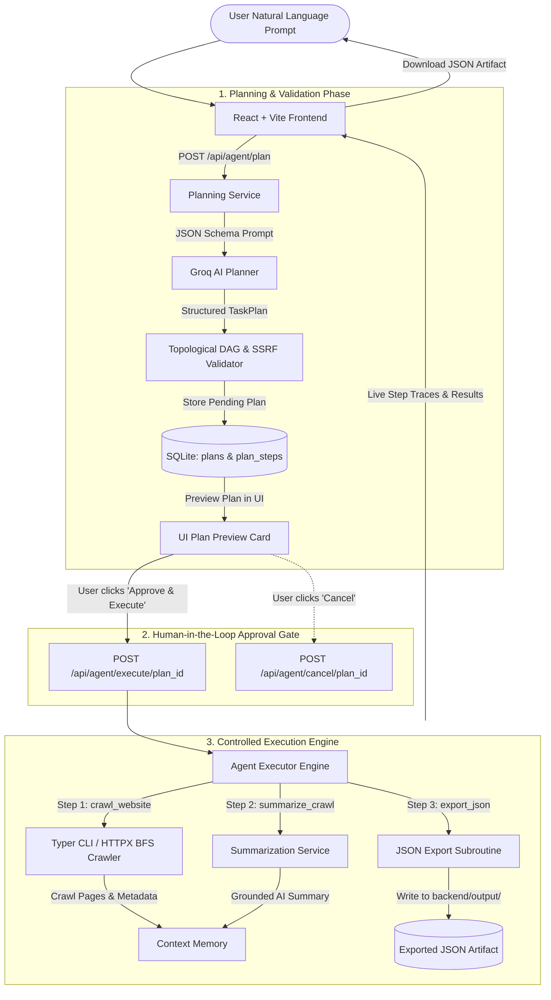

# CLI Agent AI

> **"An AI-powered conversational platform that converts natural-language instructions into controlled, verified CLI executions."**

[](#)
[](#)
[](#)
[](#)
[](#)
[](#)
[](#)
[](#)

---

## 1. Project Overview

**CLI Agent AI** is an enterprise-grade autonomous developer operations workbench built for the **BuildSprint Round 2 Implementation Challenge**.

It bridges high-level natural-language human intent and low-level command-line executions through a **Human-in-the-Loop, controlled multi-step execution engine**. Rather than allowing language models to execute unconstrained shell scripts, CLI Agent AI strictly decouples **planning** from **execution**:
1. **Groq AI plans tasks**: Decomposes complex natural language goals into structured, dependency-linked steps.
2. **Backend controls execution**: Validates the plan's topological graph, ensures parameter safety, and strictly restricts operations to an approved registry (`crawl_website`, `summarize_crawl`, `export_json`).
3. **Human confirms execution**: No operation runs without explicit user approval.
4. **Untrusted content isolation**: Crawled website text is treated strictly as passive data to prevent prompt injection.

---

## 2. Problem Statement

Modern software engineers, security analysts, and researchers frequently perform terminal tasks such as crawling web applications, parsing DOM trees, converting unstructured web documents to JSON, and auditing hyperlinks. However:
- Writing one-off web crawlers and scraping scripts is repetitive and prone to runtime errors.
- Traditional LLM chat interfaces cannot directly inspect, invoke, or monitor local terminal subroutines safely.
- Unrestricted AI terminal agents risk accidental command injection or uncontrolled system state corruption (`shell=True`, unauthorized file deletions).

**CLI Agent AI solves this** by executing all tasks through sandboxed, allowlisted subroutines with zero shell interpolation, mandatory human approval, and complete telemetry logging.

---

## 3. Key Features

- **Autonomous Multi-Step Planning**: Decomposes complex prompts into ordered DAG steps (`crawl_website` $\to$ `summarize_crawl` $\to$ `export_json`).
- **Human-in-the-Loop Safeguard**: Plans remain in `pending` status until the user reviews and clicks **Approve & Execute**.
- **Zero-Simulation Real Crawler**: Asynchronous BFS web crawler powered by HTTPX and BeautifulSoup4 with robots.txt compliance and polite delays.
- **Enterprise SSRF Protection**: Comprehensive IP blacklisting (loopback, RFC 1918, link-local, carrier-grade NAT, metadata IPs) and redirect revalidation.
- **Grounded AI Summarization**: Synthesizes executive takeaways grounded strictly in extracted HTML while defending against prompt injection.
- **Structured JSON Artifact Export**: Safely exports validated JSON files to a protected directory with one-click download.
- **Persistent SQLite History**: Full task and plan history survives application restarts with cascading step relationships.
- **Developer Telemetry Panel**: Live stdout/stderr preview, exit code tracking, duration metrics, and execution status.

---

## 4. Multi-Step Architecture Diagram



---

## 5. Technology Stack

| Component | Technology | Version | Purpose |
| :--- | :--- | :--- | :--- |
| **Operating System** | Windows 11 | Pro / Home | Native target environment (PowerShell) |
| **Frontend Framework** | React + Vite | 18.3.1 / 6.1.0 | Fast, responsive modern client interface |
| **Styling** | Tailwind CSS | 3.4.17 | Sleek developer dark theme with status indicators |
| **Icons** | Lucide React | 0.469.0 | Crisp, semantic dashboard iconography |
| **HTTP Client** | Axios | 1.7.9 | Frontend API communication |
| **Backend Framework** | FastAPI | >= 0.110.0 | High-performance asynchronous REST API |
| **ASGI Server** | Uvicorn | >= 0.28.0 | ASGI web server |
| **Configuration** | Pydantic Settings | >= 2.2.0 | Type-safe environment management |
| **CLI Framework** | Typer | >= 0.9.0 | Type-hinted command-line crawler interface |
| **AI Provider** | Groq Python SDK | >= 0.5.0 | Intent understanding & plan decomposition |
| **Database & ORM** | SQLite + SQLAlchemy | 3 / >= 2.0.0 | Persistent task, plan, and execution trace storage |
| **Crawler Engine** | HTTPX + BeautifulSoup4 | >= 0.27.0 | Controlled asynchronous BFS web crawler |
| **Containerization** | Docker + Compose | 29+ | Containerized production deployment |
| **Test Suite** | Pytest + AnyIO | >= 8.0.0 | Automated unit, graph, and integration testing |

---

## 6. Project Structure

```text
CLI-Agent-AI/
│
├── frontend/                     # React + Vite Frontend
│   ├── src/
│   │   ├── components/           # UI Components
│   │   │   ├── ChatInput.jsx     # Auto-resizing command input
│   │   │   ├── ChatWindow.jsx    # Interactive chat console
│   │   │   ├── ExamplePrompts.jsx# Canonical prompt suggestion cards
│   │   │   ├── ExecutionPanel.jsx# Live telemetry & execution details
│   │   │   ├── MessageBubble.jsx # Message & historical task renderer
│   │   │   ├── PlanCard.jsx      # Multi-step plan preview & approval
│   │   │   ├── Sidebar.jsx       # Task history & backend status
│   │   │   └── StatusIndicator.jsx # Live connection badges
│   │   ├── pages/
│   │   │   └── Dashboard.jsx     # Main developer operations page
│   │   ├── services/
│   │   │   └── api.js            # Axios client with fallback
│   │   ├── hooks/
│   │   │   └── useBackendHealth.js # Health polling hook
│   │   ├── App.jsx
│   │   ├── main.jsx
│   │   └── index.css
│   ├── nginx.conf                # Production SPA Nginx configuration
│   ├── Dockerfile                # Multi-stage production container
│   ├── package.json
│   └── vite.config.js
│
├── backend/                      # FastAPI Backend & CLI Subsystem
│   ├── app/
│   │   ├── api/                  # REST API Endpoints
│   │   │   ├── agent.py          # Plan generation, approval & execute
│   │   │   ├── chat.py           # Conversational chat pipeline
│   │   │   ├── routes.py         # Health & preview routes
│   │   │   └── tasks.py          # Persistent task history CRUD
│   │   ├── cli/                  # Standalone Typer CLI Subsystem
│   │   │   ├── crawler.py        # Typer crawl command implementation
│   │   │   └── main.py           # CLI entrypoint (python -m app.cli.main)
│   │   ├── models/               # SQLAlchemy Database Models
│   │   │   ├── database.py       # Engine, sessionmaker, init_db
│   │   │   ├── plan.py           # PlanModel and PlanStepModel
│   │   │   └── task.py           # TaskModel
│   │   ├── schemas/              # Pydantic Schemas & Validators
│   │   │   ├── chat_schema.py    # Request/response contracts
│   │   │   ├── crawl_schema.py   # PageCrawlResult & CrawlResult
│   │   │   ├── intent_schema.py  # Intent validation models
│   │   │   ├── plan_schema.py    # DAG TaskPlan & PlanStep
│   │   │   └── task_history_schema.py # Task history contracts
│   │   ├── security/             # Security & SSRF Protection
│   │   │   ├── robots_checker.py # Robots.txt parser and evaluator
│   │   │   ├── sanitizer.py      # Token sanitizer (shell=False)
│   │   │   └── url_validator.py  # Comprehensive anti-SSRF validator
│   │   ├── services/             # Core Business Logic Services
│   │   │   ├── agent_executor.py # Multi-step execution engine
│   │   │   ├── cli_executor.py   # Subprocess runner (shell=False)
│   │   │   ├── content_extractor.py # BeautifulSoup4 parser
│   │   │   ├── crawl_service.py  # Async BFS web crawler
│   │   │   ├── groq_service.py   # Groq SDK intent client
│   │   │   ├── planning_service.py # DAG task planner
│   │   │   ├── summarization_service.py # Grounded summarizer
│   │   │   └── task_service.py   # SQLite CRUD operations
│   │   ├── config.py             # Pydantic Settings (.env)
│   │   └── main.py               # FastAPI application entrypoint
│   ├── output/                   # Protected JSON artifact exports
│   ├── tests/                    # Comprehensive Pytest Suite (67 tests)
│   │   ├── test_agent_planner.py
│   │   ├── test_chat_api.py
│   │   ├── test_cli.py
│   │   ├── test_cli_executor.py
│   │   ├── test_crawler.py
│   │   ├── test_database.py
│   │   ├── test_groq_intent.py
│   │   ├── test_groq_service.py
│   │   ├── test_health.py
│   │   ├── test_phase6_e2e_integration.py # Mandatory success & edge cases
│   │   ├── test_security.py
│   │   └── test_tasks_api.py
│   ├── Dockerfile                # Production backend container
│   ├── requirements.txt
│   └── .env.example
│
├── .dockerignore                 # Container build exclusion rules
├── .env.example                  # Root environment template
├── .gitignore                    # Git secrets & artifact exclusions
├── docker-compose.yml            # Multi-container orchestration
├── DEMO_GUIDE.md                 # 4–7 Minute Live Demonstration Plan
├── SECURITY_AUDIT.md             # Security Audit Report & Findings
└── README.md                     # Comprehensive documentation
```

---

## 7. Windows 11 & PowerShell Setup

### Step 1: Clone Repository and Create Virtual Environment
Open **PowerShell**:
```powershell
git clone https://github.com/buildsprint/cli-agent-ai.git
cd "cli-agent-ai"

# Create Python virtual environment
python -m venv .venv
.\.venv\Scripts\Activate.ps1

# Install backend dependencies
pip install -r backend\requirements.txt
```

### Step 2: Configure Environment Variables
Copy `.env.example` to `backend/.env`:
```powershell
Copy-Item .env.example backend\.env
```
Edit `backend/.env` and add your Groq API key:
```env
APP_NAME=CLI Agent AI
APP_ENV=development
APP_VERSION=1.0.0
DEBUG=True
HOST=127.0.0.1
PORT=8000
DATABASE_URL=sqlite:///./cli_agent.db
GROQ_API_KEY=gsk_your_groq_api_key_here
GROQ_MODEL=llama-3.3-70b-versatile
CORS_ORIGINS=http://localhost:5173,http://127.0.0.1:5173,http://localhost:3000
```

### Step 3: Install Frontend Dependencies
```powershell
cd frontend
npm install
cd ..
```

---

## 8. Running the Application

### Option A: Single Command Launcher (Recommended)

To start both the FastAPI backend and React frontend with a single command:

```powershell
.\start.ps1
```
*(Or double-click `start.bat`)*

This script:
1. Automatically launches the FastAPI backend on `http://127.0.0.1:8000`.
2. Opens your default web browser to `http://localhost:5173`.
3. Starts the React + Vite frontend in the active terminal.
4. Cleans up both processes when you exit (Ctrl+C).

Alternatively, run as a single inline PowerShell command:
```powershell
Start-Process powershell "-NoExit -Command cd '$PWD'; .\.venv\Scripts\Activate.ps1; `$env:PYTHONPATH='backend'; python -m uvicorn app.main:app --host 127.0.0.1 --port 8000 --reload"; cd frontend; npm run dev
```

---

### Option B: Two-Terminal Development (PowerShell)

**Terminal 1 — Backend Server:**
```powershell
.\.venv\Scripts\Activate.ps1
$env:PYTHONPATH="backend"
uvicorn app.main:app --host 127.0.0.1 --port 8000 --reload
```
*Backend API available at `http://127.0.0.1:8000` (Swagger docs at `/docs`).*

**Terminal 2 — Frontend Interface:**
```powershell
cd frontend
npm run dev
```
*Frontend interface available at `http://localhost:5173`.*

---

### Option C: Docker Compose Deployment

Ensure Docker Desktop is running, then execute:

```powershell
docker compose up --build
```

- **Frontend Application**: `http://localhost:3000`
- **Backend API**: `http://localhost:8000`
- **SQLite Database**: Persisted in Docker volume `cli_agent_db_data`
- **Exported JSON Artifacts**: Persisted in Docker volume `cli_agent_output_data`

---

### Option D: 1-Click Free Deployment on Render (Single-Site Full-Stack)

You can deploy the entire application (React frontend + FastAPI backend + SQLite) to **Render.com** completely for free on a single domain.

#### Quick Setup:
1. Push this repository to GitHub.
2. In [Render.com](https://render.com), click **New** $\to$ **Web Service** and select your repository.
3. Configure the service settings:
   - **Environment:** `Python 3`
   - **Build Command:** `bash build.sh`
   - **Start Command:** `python -m uvicorn app.main:app --app-dir backend --host 0.0.0.0 --port $PORT`
4. Add **Environment Variables**:
   - `GROQ_API_KEY`: `gsk_your_groq_api_key`
   - `GROQ_MODEL`: `openai/gpt-oss-120b`
   - `PYTHON_VERSION`: `3.11.9`
   - `APP_ENV`: `production`
5. Click **Create Web Service**.

*Alternatively, click **New** $\to$ **Blueprint** and Render will automatically configure everything using the included `render.yaml`!*

---

## 9. Standalone CLI Engine Usage

The crawler runs independently via the Typer CLI without needing the web server:

```powershell
$env:PYTHONPATH="backend"

# Display CLI help
python -m app.cli.main crawl --help

# Execute crawl and output validated JSON to stdout
python -m app.cli.main crawl --url https://example.com --max-pages 5 --max-depth 1 --output json
```

---

## 10. Automated Testing Suite (72 Passed)

Execute the full automated test suite covering all phases, security bounds, and edge cases:

```powershell
$env:PYTHONPATH="backend"
pytest backend\tests -v
```

### Test Coverage Breakdown (67/67 Passed)
1. **Mandatory Success Workflow & Edge Cases (`test_phase6_e2e_integration.py` - 14 tests)**:
   - Mandatory challenge workflow: natural language $\to$ Groq plan $\to$ approval $\to$ real crawl $\to$ grounded summary $\to$ JSON export $\to$ SQLite storage.
   - Edge cases: Invalid URL, Private IP URL, Unsupported intent, Malformed Groq output, Website unavailable, HTTP timeout, Non-HTML response, Empty extraction, CLI timeout, CLI non-zero exit, Invalid CLI JSON, Replay protection, Execution without approval.
2. **Multi-Step Planner & DAG Validation (`test_agent_planner.py` - 14 tests)**:
   - DAG dependency validation, forward/circular dependency rejection, self-dependency rejection, step limits (max 5), SSRF validation, grounded summarization, step failure skipping, replay protection, cancellation, and artifact export.
3. **Database & Task History (`test_database.py`, `test_tasks_api.py` - 12 tests)**:
   - SQLite CRUD, schema migration, cascading step deletion, pagination, and persistence across restarts.
4. **Subprocess & Process Execution (`test_cli_executor.py`, `test_chat_api.py` - 7 tests)**:
   - `shell=False` verification, argument tokenization, timeout termination, non-zero exit codes, and output validation.
5. **Web Crawler Engine (`test_crawler.py` - 2 tests)**:
   - BeautifulSoup4 extraction, script/style stripping, internal/external link classification.
6. **Security & Anti-SSRF (`test_security.py` - 6 tests)**:
   - Token injection sanitizer, loopback/private IP blocking, non-HTTP scheme rejection.
7. **Groq Intent & Fallback (`test_groq_intent.py`, `test_groq_service.py` - 9 tests)**:
   - Schema adherence, URL normalization, format detection, and offline heuristics.
8. **Health & System Commands (`test_health.py`, `test_cli.py` - 4 tests)**:
   - FastAPI `/api/health`, root `/health`, and Typer `version`/`help` commands.

---

## 11. Security Architecture Summary

For the complete vulnerability analysis, mitigations, and disclosures, inspect [SECURITY_AUDIT.md](file:///c:/Users/shash/Music/CLI%20AGENT/SECURITY_AUDIT.md).

- **Subprocess Security**: `shell=False` enforced across all subprocess executions. Commands are built as immutable argument lists.
- **SSRF Protection**: Rejects RFC 1918 private subnets, loopback (`127.0.0.1`), Carrier-Grade NAT (`100.64.0.0/10`), Link-Local (`169.254.0.0/16`), and non-HTTP schemes. Validates DNS pre-flight and revalidates each redirect hop manually.
- **AI Prompt Injection Defense**: Crawled web pages are treated strictly as untrusted passive data. System prompts forbid obeying text-embedded commands.
- **Path Traversal Defense**: Exported filenames are sanitized; file writing and reading are strictly restricted to `backend/output/` via `is_relative_to()`.
- **Buffer & Resource Caps**: Max 5 MB per webpage, max 5 MB subprocess stdout/stderr capture, max 10 pages per crawl, max 2 depth.

---

## 12. Demonstration Guide

For the full 4–7 minute live evaluation walkthrough, consult [DEMO_GUIDE.md](file:///c:/Users/shash/Music/CLI%20AGENT/DEMO_GUIDE.md).

### Quick Demo Trigger:
Submit the canonical challenge instruction in the dashboard:
```text
Visit https://example.com, extract the important information, summarize it, and save the result as JSON.
```
1. Observe the structured **Plan Card** generated in `pending` status.
2. Click **"Approve and Execute Plan"**.
3. Watch the real-time BFS crawl, grounded summary synthesis, and JSON artifact generation.
4. Click **"Download Exported JSON"**.
5. Inspect the execution telemetry in the right panel and task history in the left sidebar.

---

## 13. Troubleshooting

| Issue | Cause | Solution |
| :--- | :--- | :--- |
| **Backend Offline Pill** | Uvicorn server is not running. | Run `uvicorn app.main:app --host 127.0.0.1 --port 8000 --reload` in PowerShell. |
| **`No module named 'app'`** | Python path is not pointing to `backend/`. | In PowerShell run: `$env:PYTHONPATH="backend"`. |
| **Port 8000 Conflict** | Another process is holding port 8000. | Run: `Get-Process python \| Stop-Process -Force` and restart Uvicorn. |
| **Groq API Rate Limits** | High volume of LLM requests. | The built-in rule-based DAG planner and grounded summarizer activate automatically with zero downtime. |
| **SSRF Denied on Valid Site** | DNS resolution failed or host is offline. | Ensure host has internet connectivity and domain is public. |
